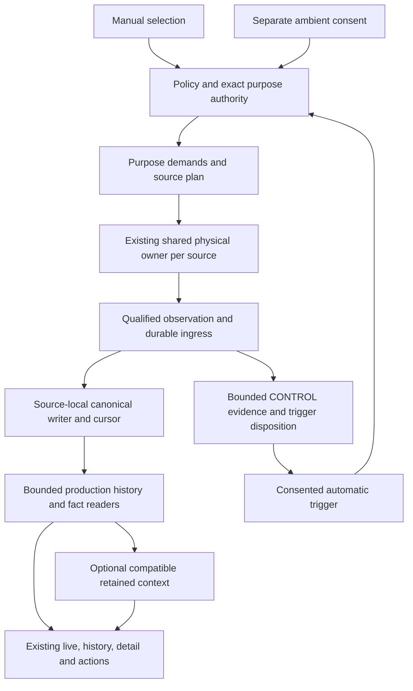

# Provider freedom: consolidated implementation proposal

Date: 2026-09-26. Prepared by four focused Astra planners: Runtime, Data, Product and Delivery, with direct peer reconciliation and coordinator source checks.

**Status: proposal awaiting approval. PLANNING_ONLY within IMPLEMENTATION_ONLY.** Existing implementation and test sources are **IMPLEMENTED_UNVALIDATED**. No compiler, test, migration, schema, lint, device, battery, CI, activation or integration gate ran for this plan. Approval of the plan would authorize its specified implementation choices; it would not activate providers/writers or approve publication.

## 1. Intended result

Users select Location, Steps, Wi-Fi and Cell freely. Every selected source records useful qualified evidence independently, in manual sessions, automatic sessions with explicit separate controls, and separately consented sessionless ambient where the source's real capability allows it. Other sources can improve presentation only from compatible data already collected. Missing Location removes geographic features; it does not remove radio or Steps history.

Complete the existing source pipeline and product surfaces. Preserve source-local writers, Room authority, Hilt, Flow, lazy physical owners, current navigation and local-only data. This plan adds no new general “brain,” permanent observer network, remote service, telemetry, dependency, identity-based radio product, new active ambient scan strategy or wholesale engine rewrite.

Detailed source traces and test cases are in [Runtime](RUNTIME_PLAN.md), [Data](DATA_PLAN.md), [Product](PRODUCT_PLAN.md), and [Delivery](DELIVERY_PLAN.md). [TASK_CONTEXT](TASK_CONTEXT.md) preserves every task message and prior proposal; [CURRENT_CODE_INVENTORY](CURRENT_CODE_INVENTORY.json) and [OTHER_RELEVANT_REFS](OTHER_RELEVANT_REFS.json) preserve exact inspected inputs. This document resolves the peers' conflicts and controls the final proposed sequence.

The user's subsequent whole-product polish request is reconciled in [WHOLE_PRODUCT_POLISH_PLAN](WHOLE_PRODUCT_POLISH_PLAN.md), supported by [UX_PRODUCT_REVIEW](UX_PRODUCT_REVIEW.md), [DATA_EXPORT_REVIEW](DATA_EXPORT_REVIEW.md) and [WHOLE_TRACKER_REVIEW](WHOLE_TRACKER_REVIEW.md). Its P1–P8 choices supplement the still-unapproved D1–D7; this revision does not presume approval. It covers setup, existing Activity/Pressure, maps, game/goals/awards, secondary surfaces, storage, files, scheduled export, privacy and accessibility. Keep existing shells and qualified metadata; remove redundant proof prose from ordinary UI.

### Settled decisions and important corrections

- Maximum source choice; all three modes where supported; one purpose-aware engine; ambient remains sessionless and separately consented; automatic trigger requirements are separate from captured sources; enrichment creates no provider demand.
- A source may be selected but currently unavailable. Preserve intent, explain its actual cause, allow usable selected siblings, and keep Stop accessible when a session is active.
- **Passive ambient Location is an approved but unfinished baseline.** `WORK_ITEMS.json:2541–2582` and `WORK_ITEM_TRACKING.md:104–119` explicitly distinguish it from optional expanded ambient Location. The current catalog has a supported identity that is **contained**, not hardware Unsupported (`SourceProductFactories.kt:354–371`). Earlier packet wording and peer recommendations to leave it contained by default do not settle or remove this obligation. Complete passive points with explicit background/ambient consent, retention/export/delete and the protected sole writer; any deliberate deferral needs explicit approval.
- Wi-Fi/Cell source-local range and `readDay` readers already exist. The missing work is shared source-aware range/discovery, mixed-session grouping and consumers; do not build duplicate source range frameworks.
- F22 “release control evidence” is release manifest/CI work, **not** Activity CONTROL retention. AUTO-005 remains a decision.
- The four-source MVP is the focus. Activity CONTROL is required for automatic operation; existing captured Activity and Pressure remain compatibility and safety obligations. New Pressure detail/selectors are an existing six-source backlog item, not an implicit new four-source feature. The global six-source assembly gate must be separately reconciled before deferred validation starts.

## 2. Exact current state and gaps

All source paths below are repository-relative; anchors are one-based in the named input. MAIN = `dev/v10` at `13f1a99871b59d29b3d059f374fc415490da6943`. ROOT = `.worktrees/source-native-map-context-root` at `de63ffded04464f48a3aee5c075d9831915918a9`. LOCATION = `.worktrees/location-product-query-20260925` at `1c17c27e15442b678e5e55139a55dd1ddc4b6b25` plus drafts. RADIO = `C:/Users/adam-/.codex/worktrees/radio-auto-capture/Tracker-Android` at MAIN plus drafts. UI = `.worktrees/unified-tracking-surface` at `487a2fc98f562e5ca418e55a0d34b68d9596a206` plus drafts. LIFECYCLE = `codex/impl-lifecycle-product-proof` at `f786563167`. No single checkout contains all of them.

Path prefixes used in the table: **engine** = `tracker/engine/src/main/java/com/adsamcik/tracker/tracker/`; **base** = `core/base/src/main/java/com/adsamcik/tracker/shared/base/database/`; **stats** = `stats/data/src/main/java/com/adsamcik/tracker/stats/data/repository/`. Full paths and additional anchors are in the companion reports.

| Current evidence | Gap that prevents completion | Plan slice |
| --- | --- | --- |
| MAIN engine `source/runtime/SourceRuntimeRegistry.kt:18`; `di/SourcePipelineModule.kt:64–99`; shared Steps/radio controllers | Good six-source lazy owner/purpose machinery exists. Dormant/contained catalog and rollout defaults do not make production starts usable. Preserve it and complete exact lane/product authority rather than replace it. | S1–S3, gates |
| MAIN engine `source/coordinator/TrackingRolloutState.kt:79–90`; `source/catalog/SourceProductFactories.kt:326–371` | Every new owner starts contained; CONTROL and ambient Location have named containment. Automatic needs approved control evidence and passive Location needs its actual baseline vertical. | S3, S5 |
| MAIN engine `source/runtime/SourceRegistrationRepository.kt:315,330`; Activity captured fact `:104`, adapter `:143,626`; base `StepsCountDomainStore.kt:1845` | Ingress starts at sequence0, some consumers reject0. LOCATION repairs Location; Activity and Steps prune remain. | S2 |
| RADIO drafts; MAIN stats `WifiHistoryComposer.kt:608–609,1012–1025`, `CellHistoryComposer.kt:414–415,729–749`; LIFECYCLE pins v1 too | Immutable radio v2/manual+automatic owner4 is drafted, but current readers require v1/owner2. Wi-Fi maintenance also needs exact fact-to-manifest pair equality. | S2 |
| LOCATION base `data/LocationAcceptedProvenanceEntity.kt:15–80`, `dao/LocationAcceptedProvenanceDao.kt:25–70`, engine `source/location/ProtectedLocationCanonicalHandoff.kt:1029+` | Sample-linked carrier is drafted; scope/writer/fence/uncertainty/receipt checks and deletion/recovery are incomplete. Canonical sample commit precedes carrier/cursor transaction. | S4 |
| LIFECYCLE stats `DefaultSourceFactQueryRepository.kt:190–286`, `DefaultLocationSampleRepository.kt:95–147`; `RoomSourceFactLookupReader` ambient refusal in Data report | Useful exact proof/retention code exists off-main, but depends on WAL, has per-sample query fanout and no ambient proof. It is neither a complete product nor ready map batching. | S1, S4, S5 |
| ROOT `feature/map/src/main/java/com/adsamcik/tracker/map/data/RadioLocationContextResolver.kt:76–118` | Resolver only; no authoritative query/renderer integration. New nearest 30-second/100m behavior differs from existing Wi-Fi bracket 30-second and Cell preceding 60-second joins. | S7 / decision D4 |
| MAIN stats `DefaultTrackingHistoryRepository.kt:387–511`; API `TrackingHistoryRepository.kt:12–74,514–531` | Recent union lacks shared arbitrary date range and treats remaining mixed entries as Physical; Steps/Pressure selections are nonactionable. | S6 |
| MAIN `feature/statistics/.../HistoryPresenterViewModel.kt:128,197,231,288`; `SourceHistoryDetailRoute.kt:70–87` (full paths in Product) | Calendar/Timeline/list still discover Trips; source detail actions are unavailable. Old source-only dates and mixed sets are not fully usable. | S6, S8 |
| UI commits `441c23b063`, `487a2fc98f`; MAIN `feature/tracker/.../TrackerDashboardControls.kt:170,185,197` | Candidate main Dashboard Stop/source-set fixes do not cover alternate Tracker Stop; Location-containing live cards still omit native radio state. | S8 |
| UI draft `DashboardAmbientSummary.kt:68–133`; ROOT `de63ffded0` reader binds | Draft mixes 24h latest radio and latest Steps day, collapses coverage/gap/unavailable and misses visible new-data refresh. Bindings alone do not complete ambient acquisition/product. | S5, S8 |
| MAIN `app/.../ActiveSessionWidget.kt:234,296,326,349`; engine `component/consumer/post/NotificationComponent.kt:111,153`; legacy radio stats repositories | Secondary surfaces remain Location/legacy-cycle-shaped. Native facts can exist without meaningful reports/notifications or with misleading zero distance. | S8 |
| Audit branch commits F13/F17/F21/F23/F24 | Saver blanket stop, elapsed Activity age and foreground-release ordering require bounded reconciliation; these fixes are not integrated. | S1, S3 |
| LIFECYCLE engine `source/runtime/WifiSourceRuntime.kt:1253–1282` | Source references `receivedWallTimeMs` absent from `wifiDelivery` parameters/member scope. Likely compile defect; no compiler result exists. | S1 |
| MAIN engine `source/runtime/WifiSourceRuntime.kt:1200–1208`, `CellSourceRuntime.kt:1385–1387` | Empty eligible radio lists return no observation. Empty schema support does not prove acquisition of fresh empty coverage. Explicit limitation or a proven new transition identity is required. | S2 / decision D6 |

## 3. One flow, distinct purposes

The CONTROL path is admitted only for the CONTROL purpose and never becomes captured history, ordinary portable source export, goals or numeric effects. Raw operational database archives are a separate sensitive-data decision P7, not an exception silently granted by this wording. Context is a read dependency with no edge back to demands. Manual and automatic create logical sessions through the same coordinator; ambient uses the same physical/fact machinery with explicit sessionless attribution. One source may support different minimal hardware handles for complementary functions, but there is one app owner and no duplicate competing writer.

## 4. Acceptance matrix

L=Location, S=Steps, W=Wi-Fi, C=Cell. Each row is required for manual and automatic capture; automatic additionally requires a separately consented viable Activity CONTROL strategy and legal fresh trigger. Table outcomes require actual qualified data, not a selected switch or registration. Empty/all-blocked selection produces a typed explanation and no false successful session. A usable selected subset may run while unavailable siblings are explained.

| Capture set | Required primary product | Optional geography |
| --- | --- | --- |
| L | Location observations/route state | Qualified Location points/route/distance |
| S | Qualified Steps and coverage | None |
| W | Identity-free Wi-Fi observation/coverage history | None |
| C | Identity-free Cell technology/quality/coverage history | None |
| L+S | Both independent states | Qualified Location |
| L+W | Both independent states | Location plus eligible observed W context |
| L+C | Both independent states | Location plus eligible observed C context |
| S+W | Both independent states; native mixed history/detail | None |
| S+C | Both independent states; native mixed history/detail | None |
| W+C | Both independent states; native mixed history/detail | None |
| L+S+W | Three independent states | Qualified Location and optional W context |
| L+S+C | Three independent states | Qualified Location and optional C context |
| L+W+C | Three independent states | Qualified Location and optional W/C context |
| S+W+C | Three independent states; native mixed history/detail | None |
| L+S+W+C | Four independent states | Qualified geographic subset only |
| Empty | No captured session; independently consented ambient may continue | Existing retained geography only |

For ambient, author coverage for all 15 nonempty L/S/W/C subsets plus empty; S/W/C cases reuse current machinery and L-containing cases depend on S5. Execute only after final freeze. Source consent/capability remains separate, so unsupported/denied ambient L must not suppress S/W/C. No ambient subset creates a fake session. Steps uses one supported continuity source, radios use the approved opportunistic mechanisms, passive Location has no continuous-route promise. Source acquisition characteristics and OS/permission limits require later platform/device evidence.

For every capture row, overlay none, same-source ambient, and independent-source ambient; deterministic tests cover the full selection product where it affects policy. Physical tests cover each solo source and representative overlap/transition combinations, not a fictitious universal hardware matrix. Ending a session preserves authorized ambient demand; disabling ambient preserves a valid session. Captured and ambient Location cannot be interchanged as context merely because wall times overlap.

## 5. Implementation order and ownership

After approval, each row produces a coherent local `IMPLEMENTED_UNVALIDATED` commit with production and focused test source, static reviewed paths, dependency receipt and deferred commands. No tests run between slices. New worktrees start from clean local `dev/v10`; preserve existing candidate/draft inputs. Shared files are edited serially by their named owner. These roles do not authorize recursive delegation.

| Slice | Owner, input and files | Concrete exit and authored evidence |
| --- | --- | --- |
| **S0 — approvals and baseline receipt** | Coordinator; TASK_CONTEXT, current refs/draft hashes, stable WI/TODO mapping | Record choices D1–D7 and whole-product P1–P8 below plus any precise deferral; retain all source refs/drafts and protected paths. Inventory existing masks, metric definitions, file codecs/scopes, raw archive databases and scheduled plans. Recheck main clean/HEAD before implementation. No rollout default changes. |
| **S1 — reconcile existing candidate work** | Data + Runtime, one coordinator for shared schema/catalog. ROOT three commits; LOCATION two commits/drafts; RADIO 22 paths; UI two commits/drafts; audit six; LIFECYCLE 26 commits | Review complete selected diffs and dependencies. Retain useful exact proof/retention semantics, native references and protected lanes; resolve Wi-Fi identifier risk, zero-generation overlap and bounded reader design. Preserve exclusions. DELIVERY_PLAN lists every input disposition; do not apply old 21-fix branch wholesale. |
| **S2 — first evidence and complete radio generation contract** | Runtime/Data; ingress consumers, Activity fact/adapter, Steps prune, Location zero draft; radio fact/writer/lane/manifest owner helpers/composers/maintenance/transfer/deletion | sourceSequence0 valid, no-prior cursor -1 where appropriate; positive ordinals/generations unchanged. v1 manual owner2 and v2 manual/automatic owner4 survive exact read/write/maintenance/export/delete checks. Test zero/replay/gap/negative/overflow, wrong pair, old facts after cutover, retained corrections, manifest swap and imported authority rejection. Empty-radio policy follows D6. |
| **S3 — source/purpose runtime and lifecycle** | Runtime; existing broker/controllers/purpose publication/catalog/coordinator/service/permissions; audit F13/F17/F21/F23/F24 | Exact selected/ready subset; no hidden control in manual; generation-safe observed-time authority; stop/retirement debt settled before FGS release; no revival after stop/reboot; saver adapts within approved floors. Implement D1 bounded CONTROL cleanup and ordinary portable export/history exclusion (P7 separately governs raw operational archives) without deleting shared evidence still required by captured Activity; test dual-purpose events across CONTROL expiry. Author full subset tests and session/ambient ownership, reconfigure, stale callback, failed unregister/registration, poison isolation and crash cases. Preferred production transitions stay dormant. |
| **S4 — protected Location retained read authority** | Data, serialized schema owner; LOCATION handoff/carrier/DAO plus LIFECYCLE receipts/retention | Implement D2 compact sample-linked immutable authority using existing canonical receipt checks, exact historical writer/scope/deletion fence and conservative uncertainty. Protected canonical writer remains sole owner. Batch queries, no per-point lookup cascade. Recovery after sample-before-carrier commit, exact replay/collision, WAL prune, retention/deletion/restore and FK cascade tests. |
| **S5 — complete sessionless ambient verticals** | Runtime/Data/Product; existing Steps/radio consent/publication/execution/readers/maintenance; passive Location backend/host/registration/handoff, catalog and source-specific storage/query/transfer | Default-off, explicit source consent, capability, approved retention, sessionless durable facts, exact native/imported origin, readable retained history and source actions. Finish a documented passive PendingIntent delivery host or explicitly approved equivalent legal host, bounded durable admission, same physical owner and generation-safe capture/passive handoff; existing process-bound callbacks alone are insufficient proof. Add passive Location attribution with purpose/provider/authorization/consent/data/deletion epochs through the protected sample writer, never fabricated session IDs. Precise host/receiver and schema/API contract is a bounded design substep presented before edits; verify platform support before choosing it. Complete ambient exact lifecycle proof; LIFECYCLE currently refuses it. Test background consent/legal start, actual registration/retirement, overlap/no double count, consent races, rearm/cancellation, source-only day/query/export/delete and session stop preservation. |
| **S6 — shared history range and exact selectors** | Data first, Product after API. TrackingHistoryRepository/union/DAO; existing Wi-Fi/Cell range/readDay and Steps day APIs | Half-open `[from,to)` or explicit stored-day request; bounded source-aware snapshot, stable opaque continuation/tie order, complete logical replacement membership before limits, explicit overflow/invalidation. Native mixed and Steps selection; imported provenance retained. Old days beyond recent-page limit discoverable. D3 sets visible day/count/action scope. Pressure selector is only included if necessary for unchanged shared contract or specifically approved older six-source completion. |
| **S7 — optional radio context and native reports** | Data/Map after S2/S4 and S5 for ambient; resolver, bounded map query, renderer, MapDataChangeObserver, source-native aggregate statistics | D4 observed-device-point policy; authenticated native radio + Location context for exact captured-session scopes and compatible sessionless ambient scopes, matched/total/omitted states, no inferred AP/tower identity or stored derived coordinates. Either input's fact/cursor/epoch/deletion/retention changes invalidate active readers. Radio history survives absent context. Report native aggregate metrics with legacy identity metrics labelled separately. |
| **S8 — shared product completion and actions** | Product plus source action owners; existing Settings/Dashboard/Tracker/Statistics/detail/Calendar/Timeline/list/widget/notification/import-export | Reuse source cards for all sets including Location-containing; correct both Stop surfaces; truthful source-specific repair/status. Preserve timed-lock/until-charging/just-stop options and explain that session Stop leaves separately enabled ambient running. Finish D5 Between sessions view; old ambient retained history remains discoverable after disabling. Add minimal “Why recorded”: source, direct purpose, observed time, controlling setting/consent, session versus ambient and optional context provenance; do not expose opaque IDs as the primary explanation. Wire supported source export/delete with exact reauthentication, cancellation/stale/retry state and existing file flows. No Trip-ID guessing or GPX for radio-only. Widget/notification show duration/source states and no fake geographic metrics or Location-cycle dependency. Compose/accessibility/large-text/navigation/action tests. |
| **S9 — privacy/schema/global completion accounting** | Coordinator + schema/Data; AppDatabase/migrations/markers/full-clear, backup/restore, retention workers/invalidation; existing six-source work items | One additive final source schema preserving all released v27 facts; stale development-v28 files remain safe; no orphan carriers or restored deleted context. At S0 identify exact remaining `WI-PRESSURE-PRODUCT-001`, `WI-ACTIVITY-VERTICAL-001`, `WI-NONSTEPS-EFFECTS-001`, `WI-CROSS-SOURCE-RECOVERY-001` and `WI-CROSS-SOURCE-PRIVACY-001` obligations and inherited approvals; resolve their disposition here. Preserve safety/compatibility, complete only existing approved scope, and present named deferrals/new presentation choices before edits. No broad Pressure redesign is silently added. Author populated migration, fresh/migrated reopen, corruption preservation, rollback, maintenance and complete scenario sources. |
| **S10 — freeze, convergence, proof and integration** | Coordinator, fresh reviewer, one representative device | Follow section8; final frozen input, one batch and fixes, honest evidence, distinct device activation authority, fresh assembled-code review, clean local rebase/merge and integrated verification. No push or release. |

### Whole-product additions to the same sequence

The planning-only checkpoint for this follow-up is `d6a813e41e`; section2's ROOT `de63ffded0` names the earlier production candidate input, not the latest documentation HEAD. Main and candidate production inputs remain unchanged. The following are bounded additions, not a parallel framework or blanket approval. Full source evidence, scope/alternatives and acceptance journeys are in WHOLE_PRODUCT_POLISH_PLAN §§2–7.

| Placement | Owner and concrete change | Authored acceptance before final freeze |
| --- | --- | --- |
| **S3a — chosen intent and dependent eligibility** after S3, subject to P1/P3 | App/Runtime: setup saves desired masks/automatic intent independently of current permissions; presets change quality without adding unchosen Pressure or migrating existing masks. Explicit saving/failure/retry and safe completion ordering. Precision upgrade qualifies actual ended approximate-Location session. Game/My location share a fresh eligible Location owner under approved feature scope, never generic service-active state or capture enrollment. Game owner API/freshness remains a pre-edit subdesign. | Steps-only setup with denial and no Pressure; partial setup retry; nonLocation never contributes to precision prompt; game during each source set and independent stops/revocation; no duplicate listener or game-only persisted capture. |
| **S6/S8 — whole-application consumers** after exact queries | Product/Data/Game: remove Trip-only Statistics empty gate and weekly Steps suppression; source-aware reports, widgets and notifications; preserve current navigation/customization. Shared Sessions uses D3 identity, movement time/distance remain qualified. Keep exact READY Steps goals/awards and idempotent correction receipts. Points Today uses structural-day interval and existing day/zone invalidation. | Zero Trips with valid native/ambient/imported history; actual partial/unavailable states; later award while subscribed and midnight/zone/replay; Activity/Pressure compatibility and no invented rewards. |
| **S8a — portable files, ranges and share facts** after S2/S4/S5/S6 | Data/export: add narrow native/ambient radio adapters and required passive Location point export using existing source contracts; version/extension/point format approved before edits. Minimal registry capability metadata and format/scope-qualified availability replace legacy hasTrips gating; valid exporter-supported records without a physical Trip remain eligible, and selected-scope empty differs from global empty. Actual source scope/count units in result/share, one final sensitivity confirmation. Preserve JSON3 whole-intersecting-session scope with explicit label; preserve descriptive accuracy/quality without native authority. Geographic range exports retain exact interval; GPX splits proven session/segment/gap boundaries and excludes passive points from routes. KML unknown/estimated time is explicit under P6. | Every supported source/detail/global format discoverable without enum filtering; real-byte metadata/units/origin/CONTROL assertions; whole-entry versus point-boundary/DST tests; disjoint sessions do not connect; partial/unknown import remains partial/unknown. No silent loss of existing date-range export. |
| **S8b — scheduled scope and failure closure** | Data/export: missing LastSession is typed no-data before destination creation, never null→all-history. Location cursor called New location points; JSON snapshot and fixed30/365-day scopes labelled honestly. Cancellation-safe output close/cleanup; report residual file if deletion refused; share actual export result, partial import outcomes. | No eligible last session/retention race cannot widen selection; no watermark on failure/cancel; replay/correction limits explicit; file close and cleanup failures distinguishable; stale selection reopens, overflow narrows range, deterministic integrity failures do not offer useless Retry. |
| **S9 — privacy and earned UI text** | Product/Data: exact P7 raw archive policy and existing scheduled-plan disposition, deletion/retention progress and scope, explicit external-export limitation. Concise ordinary copy, full Details/file metadata; density-not-dwell terrain, accurate game persistence, contextual Session labels. Inspect notification-management failure/reorder and private export cache cleanup before edits. | Durable deletion pending versus complete; full-clear derived/game/diagnostic scope; archive includes only its explicitly approved operational scope and has no restore claim; localized dates/plurals/units, one control semantics, Stop/action reachability at large font. |

No new reward source, dwell engine, full archive restore, multisource delta protocol, active ambient strategy, generalized export engine or app-wide visual redesign is proposed. Existing Activity/Pressure products and all six-source assembly obligations still apply; scope review cannot silently remove them.

## 6. Data and enrichment invariants

1. **Primary durability first.** Fresh accepted source observations commit under exact policy/purpose/provider/boot/authorization and immutable owner. Requests, registrations, caches, timer ticks and Steps baselines are not complete observations. Identical provider content/time replay has zero effect; newer provider time is handled under the source's real contract. A source-local failure must not stall unrelated source startup/drains.
2. **History authority differs from write authority.** New mutations require the current sole destination owner; retained historical facts authenticate their exact immutable manifest/lane/writer/cutoff. They cannot be invalidated merely because a later writer owns new data. Never accept two supported generations without equality between the actual fact and actual manifest.
3. **Retained Location proof.** Authenticate sample/decision/receipt bytes, source event, writer generation, exact scope, observed/received time with uncertainty, boot/clock, current collected epoch, historical consent and current deletion/retention authority. Carrier follows sample deletion; full/source erase, retention and recovery cover both. Reconcile the draft's unique sample/event carrier with one accepted delivery legitimately eligible for both capture and ambient: retain distinct purpose authority without duplicate canonical samples, and retire only the revoked/deleted purpose while another valid purpose survives. The exact association representation is part of S5's pre-edit subdesign. Canonical sample and later carrier/cursor handoff are crash-reconciled, not falsely described as one transaction. A Boolean eligibility field from a caller is not proof.
4. **Context is optional and read-derived.** Native captured matches require exact logical session/run/segment/boot/clock/data scope and each input's own authenticated source consent/manifest authority; numerical consent IDs need not be equal across sources. Reject stale, foreign/imported, erased and purpose-incompatible context. After S5, ambient radio context requires both inputs to have authenticated AMBIENT_PRODUCT eligibility at observation time, matching global collected-data epoch/boot/clock, overlapping compatible authorization/retention intervals and current source-specific deletion fences; each source's consent is independently authenticated. It never borrows a session fix or invents a run ID. D4 proposes this distinct typed sessionless scope alongside the captured scope.
5. **Queries are bounded.** Reuse the facade, fixed-count batch readers and source-local ranges. Bound candidates, replacements, facts and output; return partial/overflow/invalidation honestly. Do not page blindly until enough accepted rows appear or run one proof query per point/list row. Use injected IO dispatchers, cancellation and consumer-scoped invalidation.
6. **Portable data is not local authority.** Keep imported origin and source-owned formats; a matching opaque event string/time cannot create local provider, WAL, session, consent or geo-join authority. Validate v1/v2 transfer compatibility; stale selection and all mutation scopes reauthenticate. CONTROL remains absent from ordinary captured/ambient portable export, goals and history; raw operational database archive handling requires the separate P7 decision. Preserve descriptive accuracy/provider/quality on compatible imports without conferring native trust; unknown or synthesized time cannot authorize time-dependent joins/rewards. When a delivery is legitimately eligible for both captured Activity and CONTROL, CONTROL expiry retires its control-only authority/payload without deleting a shared WAL/receipt still required by captured history; independent capture retention cannot prolong trigger validity.
7. **Maintenance cannot resurrect data.** Persist deletion fences before payload removal, preserve enough authority for bounded retained replay, reconcile correction dependents atomically, and invalidate maps/history. Deleting Location removes dependent context while radio survives; deleting radio removes its layer without erasing unrelated Location. Preserve backup deletion markers and no-resurrection on merge import/restore. Technical rollback is not a privacy deletion.
8. **Existing privacy remains.** Local-only tracking; map egress only through the existing user-enabled NetworkGateway. Tracebox stays local and payload-free. No new identifiers, coordinates in diagnostics, telemetry or automatic upload. Existing approved retention values remain; do not invent a new source-duration default.
9. **Presentation and files use the same scope.** Capture off or current permission loss does not erase retained historical authority. Reauthenticate eligible read/export scope against actual retention/deletion/consent contracts; do not apply a blanket current-permission gate. Distinguish transient failure (Retry), stale selection (reopen), bounded overflow (smaller period), deleted/not-found and deterministic unverifiable authority. Share text/counts come from actual export results, not a differently scoped legacy Trip summary. One unknown value never becomes zero or inferred completeness.

## 7. Scoped edge-case and test-source checklist

The companion reports identify concrete existing suites. Author meaningful contract/Room/UI cases now; execute them only after freeze. These are acceptance obligations, not claims that tests pass.

| Family | Cases that must have an owner and expected result |
| --- | --- |
| Selection and capabilities | All 15 plus empty, all blocked, usable sibling, missing sensor/SIM/provider, GMS/Health Connect unavailable; platform radio Location permission does not enable Location capture; saved intent survives repair/denial. |
| Automatic | CONTROL off/unavailable/expired, valid Transition versus sample callback, stale/duplicate trigger, automation/policy/boot changes, background start rejected, exact FGS envelope, captured set independent of control, no implicit Steps corroboration. Preserve existing timed-lock/until-charging/just-stop actions; session Stop does not revoke ambient consent. |
| Ambient | Default-off, separate source consent, permission/revoke during read/admission, source host unavailable, rearm after permitted lifecycle, same/different-source session overlap, no duplicate owner/count, session stop preserves ambient, ambient stop preserves session. Passive L produces points without route guarantee/fake session. Same Location delivery capture+ambient replay, purpose-specific delete/revoke/retention and surviving-purpose query must preserve one canonical sample. |
| Temporal | First sequence0, empty history, replay0, gap, overflow, duplicate content with same versus new provider time, mixed-age radio children, future/missing time, delayed callback, wall jump/uncertainty, boot/clock mismatch, DST/time zone/midnight. |
| Provider transitions | Authority-only change without restart; physical change with accepted replacement or explicit break gap; registration/unregistration failure, permission loss, queued old callback, stop during prepare/start/drain, repeated/superseded stop, last available source removed. |
| Lifecycle | WAL commit then kill, sample commit before carrier, cursor/fact transaction failure, process death/reboot/update/force-stop, stale automatic outbox, exact recovery fences, no finalized revival; force-stop recovery is not promised without real platform evidence. |
| Isolation and budgets | One poisoned source/partial SIM, callback queue saturation, transaction contention/low storage, cancellation, bounded retries, max query/replacement budget, large store and stable paging ties; explicit gaps/unavailable instead of silent completeness. |
| Materialization | One canonical writer, old writer paused during cutover, wrong manifest/generation/owner, v1 retained after v2, exact replay versus collision, correction chains and removed dependents, cold recovery. |
| History and navigation | Source-only ancient dates, multi-run logical group, changing manifest sets, mixed nonLocation capture, zero-fact waiting entries, native/imported collisions, one-use token expiry/process recreation, stale navigation/old async month response. |
| Privacy/actions | Single source versus logical session scope, active/legacy/mixed unsupported destructive scope, concurrent correction/delete/retention, cancel/retry/export limits, portable import reexport, receipt/fence survival, CONTROL exclusion, dual capture+CONTROL event across CONTROL TTL without captured-history loss or trigger extension, full-clear backups, no resurrection. |
| Maps | No eligible Location; selected L but no fix; only historical eligible L; ties/invalid accuracy, same wall time wrong scope, post-WAL carrier, either input deletion/prune/revoke, foreign event spoofing, partial counts; never call broker/provider from query/render. |
| Product states | Disabled, unsupported, permission-needed, contained, OS-limited, waiting, active, recording, materializing, ready, partial, degraded, failed, deleted/unverifiable. Baseline/absent/partial Steps is not zero. Radio gap-only is not confirmed empty. |
| Secondary surfaces | Dashboard and alternate Tracker Stop, start widgets/shortcuts, native fact notification refresh without Location cycle, no speed/distance/path for noLocation, qualified Steps retained, no stale other-segment values. |
| UI/lifecycle | Visible invalidation, resume, no observers after stop, accessibility text/reading order/touch targets/large fonts/non-color partial state, action labels and actionable errors, preserved edits and source selection. |
| Migration/backup | Populated v27 all released facts; exact final v28 fresh/migrated reopen; real FK cascades/rollback; old development-v28 marker/table/index mismatch; corrupt/contended main/WAL/SHM/journal preservation; guarded startup/backup recovery before runtime; no destructive reset. |
| Battery and quality | Saver/Doze/screen-off/thermal transitions, floors versus optional adaptation, finite direct-demand radio attempts, no polling demand for context/UI, measured physical tier differences and listener retirement; claims limited to actual representative evidence. |
| Whole-product journeys | WHOLE_PRODUCT_POLISH_PLAN §7: setup exact intent/no hidden Pressure; source-only Stats with zero Trips; game with nonLocation capture; qualified Activity/Pressure; ambient point files; later XP/Steps correction; retained map without permission; DST/disjoint-route exports; LastSession absent; cancel/partial import; archive/delete race; actual small-screen/locale/accessibility. |

Trace these families to existing `WI-BROKER-PROVIDER-OWNERSHIP-001`, `WI-LIFECYCLE-RUNTIME-001`, `WI-LIFECYCLE-PRODUCT-PROOF-001`, `WI-STEPS-*`, `WI-LOCATION-*`, `WI-WIFI-*`, `WI-CELL-*`, `WI-SHARED-HISTORY-DAY-RANGE-001`, `WI-SOURCE-ACTIONS-EXPLANATION-001`, `WI-UI-SURFACES-001`, `WI-CROSS-SOURCE-PRIVACY-001`, `WI-CROSS-SOURCE-RECOVERY-001`, `WI-INTEGRATION-SCENARIOS-001`, `WI-QOS-BATTERY-001`, and the assembly/validation IDs. The existing 293 requirement mappings measure ledger coverage, not behavioral proof. Preserve stable IDs and add narrow receipts only where justified.

## 8. Convergence and readiness

**Freeze means implementation inputs are complete, not that reliability is already proven.** All selected production/test-source slices and global six-source assembly prerequisites must be accounted for, decisions resolved or explicitly scoped, and drafts committed/preserved with exact hashes. Four-source implementation alone cannot declare `WI-ASSEMBLY-GATE-001` complete; its broader dependencies at MAIN `WORK_ITEMS.json:6148` include Activity, Pressure, privacy, effects, recovery and shared actions/history. Finish necessary existing work or obtain explicit scope disposition before announcing the permitted phase switch.

Once frozen, run one coordinated convergence batch: production and test compilation/Hilt/Room; generate and review final additive v28 schema while preserving v27; focused changed-source contracts/real Room tests; populated Android migration/open/reopen/recovery; `./gradlew.bat ciUnitTest`; `./gradlew.bat ciCheck --continue`. Expected generated schema must be committed before the schema clean-tree gate. Fix resulting failures and rerun the complete gates on the final corrected input. No early execution is authorized by this plan.

`ciCheck` includes host suites, build-logic tests, release lint, Detekt, architecture, Room drift and SQLite runtime verification; root build also adds release-validator fixture/dependency metadata tests. It does not establish connected migration, actual provider callbacks/listener retirement, TalkBack, battery or release-package evidence. Sources: MAIN `RootVerificationConventionPlugin.kt:94–119,389–416,500–519` under `build-logic/convention/.../buildlogic/`; root `build.gradle.kts:134–190`. F22 is a separate release evidence change; do not run a publishing workflow to prove this local MVP.

After host/schema success, real candidate execution needs its distinct explicit bounded local device/activation authority. The earlier automatic review rejected changing preferred radio V1→V2 bindings as prohibited phase activation. Keep that rejection effective; test fixtures can exercise contracts without enabling production defaults, but cannot substitute for or smuggle in real provider activation. Present the exact source/purpose/generation, dedicated device/profile, rollback and measurement scope for approval before crossing it.

Use one representative Android device and one representative emulator/API setup if needed for UI/migrations. Prove each solo L/S/W/C and representative mixed, automatic-control and session+ambient intersections through actual provider → qualified durable event → sole canonical fact → production query → visible product → listener retirement. Exercise permission revocation, screen-off, saver/Doze, process kill/reboot and actual supported continuity/radio behavior. Record capability gaps honestly; a mock/host pass is not physical evidence. Measure repeated comparable quality/cost workloads before advertising better battery or activating a tier; no remote telemetry, fleet claims or arbitrary device matrix.

Before final integration, a **fresh independent review-only agent** gets all original user messages and follow-ups, approval receipt, exact assembled code/diff, test source and actual gate results. It checks requirement coverage, correctness, regressions, unapproved choices and complexity. The four planning reports are not this review. Resolve concrete findings and recheck affected areas; rerun complete required gates after final fixes.

Then rebase the finished branch on latest clean local `dev/v10`, verify the changed integrated input, merge locally, and verify final HEAD/tree and required behavior. Preserve unrelated work and retained handover refs/drafts. No push, release, deployment or ongoing candidate promotion is authorized; cleanup uses managed worktree lifecycle only when safe.

## 9. Consolidated approval choices

These are the remaining new decisions under the replacement AGENTS instructions. They can be approved as one proposal with exceptions. Previously settled source freedom, sessionless consent and the approved passive Location baseline do not need to be asked again. No suggested number becomes policy before approval.

| ID | Recommended concrete choice | Meaningful alternative / tradeoff |
| --- | --- | --- |
| **D1 CONTROL privacy** | Fixed **24-hour maximum** for the minimal Activity CONTROL evidence required to authenticate legal triggers/recovery; no captured history/ordinary portable export/effects (raw archives require P7). Reuse existing exact event/boot/provider/authorization/consent/automation/disposition fields, retain no extra raw identity, enforce trusted retention and replay expiry. Captured Activity keeps separate approved retention: retire expired CONTROL authority, but preserve shared carrier bytes legitimately required by capture without extending control validity. | Until session end minimizes retention but loses bounded recovery history; 7 days increases diagnosability and local retention. TTL implementation must not prolong stale-start validity. |
| **D2 Retained Location authority** | Compact authenticated sample-linked carrier, reusing existing receipt checks and adding exact writer/scope/fence/uncertainty evidence; batch query after WAL pruning. Keep separate authority associations for capture and ambient eligibility of the same accepted delivery, with one canonical sample and no duplicate effects; retire associations per purpose and delete the sample/carrier when no retained authorized purpose remains or full sample deletion applies. Protected sole canonical writer unchanged. | Keep necessary WAL/receipts as long as samples: less duplicate proof representation but larger storage and coupled retention. Exact carrier schema/API is presented as a bounded subdesign before new edits; unverifiable evidence stays unavailable. |
| **D3 Existing history/detail/actions and dates** | Source-aware mixed/native Steps rows and existing detail shell; bounded shared date union. Show a logical session on each intersected stored-zone day with “continued”; attribute session count once to its start day, deduplicate by logical identity across ranges, allocate numeric values only where evidence permits. Source-detail actions target that source; mixed detail exposes source-specific actions, no new bulk-delete behavior. | Start-day-only discovery is simpler but hides subsequent-day evidence. Whole-session mixed export/delete needs a separate exact scope contract; omit it initially rather than guess. |
| **D4 Optional map meaning** | Observed radio aggregates at **accepted device Location points**, never AP/tower positions. An exact-equal Wi-Fi fix qualifies directly; otherwise require valid bracketing fixes within existing 30-second limit and choose the closest accepted endpoint (preceding then stable-ID tie). Cell chooses preceding/equal fix within existing 60-second. Proposed accuracy cap **100m**, with time separation/accuracy and omitted count visible. Include exact captured scope and the separately authenticated compatible ambient scope in section6; never cross purposes. This is a new point-display/scope policy even though time bounds are reused. | Existing interpolation estimates device position between fixes; uniform nearest 30-second changes Cell direction/limit. Canonical qualification with accuracy disclosure and no new 100 m cap retains more points but accepts coarse context. A captured-only first version explicitly defers ambient context and requires that named scope choice. Choose explicitly; no hidden threshold. |
| **D5 Ambient product** | Small Between sessions section using a labelled stored structural day and typed per-source evidence/availability, exact Steps partition, native radio coverage states and passive Location points when supported. Existing source invalidation plus visible resume refresh; no fixed 30-second polling or new 24-hour data window. Retained history remains available after collection is disabled. | Latest 24-hour snapshot and visible 30-second refresh is simpler for a draft but has window mismatch/read cost and needs explicit approval. Current peer ambient drafts are reworked, not accepted as final. |
| **D6 Empty radio evidence** | For this MVP, explicitly report waiting/no qualified observation for empty or unprovable callback deliveries; do not claim confirmed zero coverage. Keep timestamp-proven nonempty/unchanged observations. Record this as a named limitation relative to the older fresh-empty vision. | If positive fresh-empty coverage is required now, first design a narrow provider-transition identity using verified platform evidence, then its durable header/replay tests. Do not stamp receipt time onto cached emptiness. |
| **D7 Global assembly scope and remaining privacy** | Complete the approved passive ambient Location baseline; preserve/finish existing six-source safety/shared contracts necessary for global freeze, while keeping new Pressure presentation and optional radio identity/elevation outside the four-source expansion unless separately approved. D4 specifies compatible ambient context as a read-only product. Reuse approved per-source retention values/copy; identify any unresolved source/purpose duration precisely before implementing it. | Explicitly defer named old requirements and amend the global phase gate before a narrower MVP validation. Do not silently treat catalog containment, “where supported,” or the four-source plan as rescinding old accepted requirements. |

The map slice implements captured context first and compatible ambient-to-ambient context after S5, under D4's explicit scope contract. “Optional” means a user can record radio without Location and still gets useful radio history; it does not mean silently dropping the planned compatible ambient reader. No new acquisition is allowed for either. The exact passive Location delivery host and sessionless carrier API are the bounded S5 design substep; existing callback/passive-request code alone does not prove a durable background host.

### Additional whole-product approval groups

The exact proposals and alternatives are in WHOLE_PRODUCT_POLISH_PLAN §5; these summaries make their relationship to D1–D7 explicit. Approve with exceptions rather than treating broad source freedom or the request for polish as approval of new behavior. A choice marked pre-edit subdesign remains unresolved after high-level approval until its concrete contract is presented.

| ID | Recommended decision | Alternative / remaining boundary |
| --- | --- | --- |
| **P1 Setup/presets** | Persist selected intent despite current denial; presets change quality only, fresh unoffered Pressure off, existing masks preserved; explicit saving/retry and idempotent safe completion. | Offer Pressure explicitly during setup; greater onboarding cost. A disclaimer about hidden Pressure is insufficient. Exact retention initialization/completion order reviewed before edits. |
| **P2 Product facts/copy** | Existing screens cover qualified source history; logical session count, movement-qualified duration/distance, unchanged qualified Steps rewards; concise state/action and technical Details; source-aware secondary surfaces. | Explicitly label legacy-only dependent metrics while named adapters are deferred, never hide primary history or invent rewards. |
| **P3 Feature Location/prompts** | Retained map browsing without current-position gate; explicit game/My-location uses one existing owner with fresh eligible feature demand and no capture enrollment. Precision prompts count actual eligible ended Location sessions only. | Exact purpose/handoff/freshness contract is pre-edit; if unsupported, show feature unavailable rather than duplicate providers. |
| **P4 Source exports** | Narrow native/ambient radio and passive Location point adapters using existing transfer contracts; applicable registry formats, actual source scope/count units and one final sensitivity confirmation. | Version/extensions/point contract remain pre-edit design; named unsupported formats cannot be advertised as completed source actions. No new generalized format framework. |
| **P5 Date/geographic files** | Exact geographic interval; whole intersecting portable logical entries explicitly labelled; preserve JSON3 whole-session compatibility. Preserve GPX date-range action with proven session/segment/gap separation; passive points never continuous routes. | Versioned JSON clipping or explicit temporary GPX limitation requires named choice. Exact gap/unknown-group fallback remains pre-edit; do not silently remove existing range export. |
| **P6 Import/scheduled truth** | Preserve descriptive measurement quality separate from imported trust; explicitly mark KML unknown/estimated timing. Missing LastSession is no-data. Location-only append named honestly, JSON snapshot, fixed30/365-day labels. | Reject untimed KML instead; timing representation remains pre-edit. Calendar intervals or multisource deltas are separate features, not included. |
| **P7 Raw archive privacy** | Explicit sensitive operational Database archive may contain CONTROL/runtime/legacy identifiers; separate final disclosure and approved exact database/table scope. No settings/resources, cross-database atomicity or restore claim. Reconcile scheduled raw archive authority; recommend defer recurring raw archives until explicit recurring-sensitive-export scope is approved. | Explicitly remove/defer raw archive, or separately design filtered format. Never silently filter/broaden existing backups or infer CONTROL egress consent from ordinary export. Existing scheduled plans need an approved disposition. |
| **P8 Failure/deletion** | Cancellation-safe file cleanup with residual-file reporting; actual export/share counts; partial import outcomes; durable deletion pending/completed and real derived/game/diagnostic scope, external exports distinct. | Provider refusal may leave a file and needs a remove/recovery action, not false success. No new full restore or blanket import confirmation. |

## 10. Coverage and remaining unknowns

The four reports cover runtime/provider ownership, data/writers/reads/privacy, all identified product consumers, branch/draft/schema convergence and delivery gates. They include exact source anchors, verified contradictions and acceptance cases. They do **not** prove literal universal edge-case completeness or that every historical log line was reread. Delivery fully read the task, handover and current execution/runbook/index documents, inspected current verification matrices and registry dependencies; peers read their role-specific durable sections. Older repeated logs and unrelated code are explicitly outside that reread scope.

Before implementation/freeze, finish the selected LIFECYCLE diff/dependency review, verify portable v2 compatibility, finalize the passive Location sessionless carrier/interface and retained-authority shape, inspect legacy Location import/restore impacts, reconcile existing retention approvals, and account for every broader six-source assembly prerequisite. Deployment history must not contradict the unshipped-v28 premise; if it does, obtain a migration strategy. Verify OS/API guarantees from official platform documentation and actual environment when needed; current source guards alone do not establish them.

The whole-product follow-up additionally requires bounded completion of feature Location ownership/freshness, passive point/radio file contracts, GPX grouping/gaps, imported timing representation, raw archive database/scheduled-consent inventory, non-Steps metric definitions, notification-management failure/reorder inspection, export-cache cleanup and changed locales. These have owners and approval boundaries in the polish plan; no new platform is implied. The three whole-product reviews cover the identified application seams, not every line or an executed visual/device audit.

The plan is ready for approval of its explicit choices, followed by bounded pre-edit subdesigns where listed. The repository is not yet proven ready for practical provider testing, final integration or activation.
